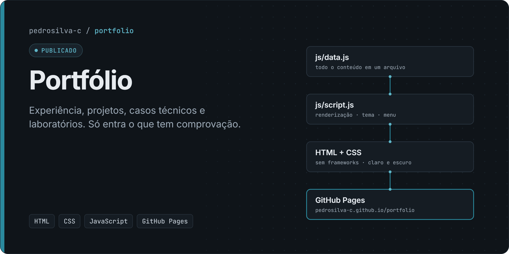
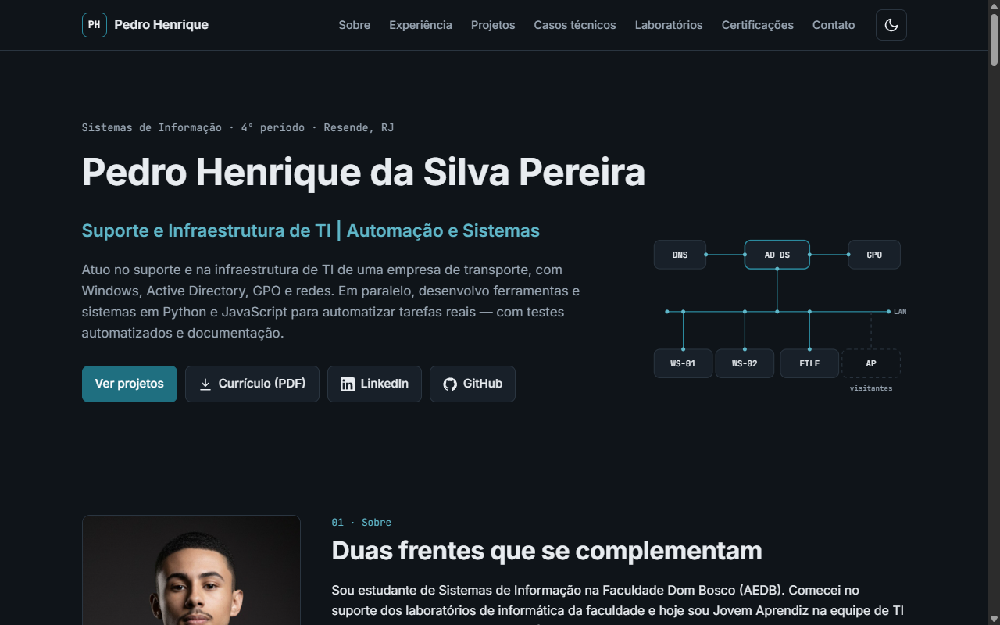
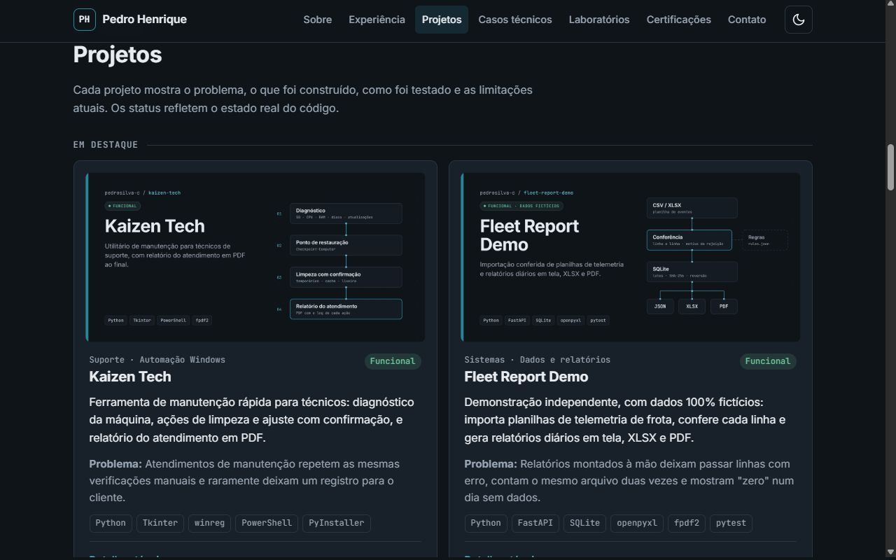

# Portfólio — Pedro Henrique da Silva Pereira

> **Status: publicado** em https://pedrosilva-c.github.io/portfolio/

Portfólio estático de **Suporte e Infraestrutura de TI | Automação e Sistemas**, com experiência profissional, projetos, casos técnicos, laboratórios e certificações.

**[Abrir o site](https://pedrosilva-c.github.io/portfolio/)** · **[Perfil no GitHub](https://github.com/pedrosilva-c)**

## Problema

Um portfólio de TI costuma misturar o que foi feito com o que foi só estudado, com barras de "nível" e contadores sem comprovação. Este site segue uma regra editorial simples: só entra o que tem evidência, e o que está incompleto aparece com status honesto (WIP, Em documentação, Planejado).

## Funcionalidades

- Seções de experiência, projetos (em destaque e outros), casos técnicos reais, laboratórios, tecnologias e certificações, todas geradas a partir de um único arquivo de dados.
- Cada projeto mostra problema, o que existe, testes e limitações, com link para o repositório e, quando há, para a demo.
- Temas claro e escuro: segue o sistema e guarda a escolha do visitante.
- Formulário de contato que abre o e-mail do visitante (`mailto`), sem enviar dados a servidores.
- Currículo em PDF (sem telefone) e imagem de compartilhamento para LinkedIn e WhatsApp.
- Metadados de SEO: canonical, Open Graph, Schema.org (`Person`), sitemap e robots.

## Tecnologias

HTML, CSS e JavaScript sem frameworks nem etapa de build · fontes Inter e JetBrains Mono (Google Fonts) · ícones SVG inline · GitHub Pages.

A identidade visual (cores, tipografia e as capas dos projetos) é a mesma do perfil no GitHub e está documentada em [`pedrosilva-c/brand`](https://github.com/pedrosilva-c/pedrosilva-c/tree/main/brand).

## Demonstração





## Estrutura

```
index.html            página principal (marcação das seções)
js/data.js            todo o conteúdo: experiência, projetos, casos, labs, tecnologias, certificações
js/script.js          renderização a partir de data.js, tema, menu mobile e formulário (mailto)
css/style.css         estilos e tokens de design (tema claro e escuro)
labs/                 páginas dos laboratórios
blog/                 notas de estudo não listadas (noindex), mantidas com aviso de uso de IA
assets/               currículo público (sem telefone), foto, favicon, capas e imagem de compartilhamento
_source/              fontes do currículo e da imagem Open Graph (ignorado pelo GitHub Pages)
docs/assets/          imagens deste README
```

Para atualizar o conteúdo, edite apenas `js/data.js`. Um projeto com `featured: true` e `cover` aparece no grupo "Em destaque".

## Como executar

```bash
python -m http.server 8080
# abra http://localhost:8080
```

### Regerar currículo e imagem de compartilhamento

Com o Microsoft Edge (ou Chrome) instalado, a partir da raiz do repositório:

```powershell
$edge = "C:\Program Files (x86)\Microsoft\Edge\Application\msedge.exe"
& $edge --headless=new --no-pdf-header-footer --virtual-time-budget=5000 `
  --print-to-pdf="$PWD\assets\curriculo-pedro-henrique.pdf" "file:///$PWD/_source/curriculo.html"
& $edge --headless=new --hide-scrollbars --window-size=1200,630 --virtual-time-budget=5000 `
  --screenshot="$PWD\assets\images\og-cover.png" "file:///$PWD/_source/og-cover.html"
```

As capas dos projetos vêm do gerador em [`pedrosilva-c/brand`](https://github.com/pedrosilva-c/pedrosilva-c/tree/main/brand), reduzidas para 1280×640.

## Testes

Não há suíte automatizada neste repositório. A cada publicação, faço verificações com Playwright (Chromium), registradas nos commits:

- larguras de 375, 1024, 1280 e 1440 px, nos temas claro e escuro;
- nenhum erro ou aviso no console e nenhuma rolagem horizontal;
- todas as imagens carregadas e todos os links internos e externos respondendo;
- menu mobile, alternância de tema e formulário `mailto`;
- contraste WCAG AA dos pares de cor de texto nos dois temas.

## Limitações e status

**Status atual: publicado.**

- O formulário depende de um cliente de e-mail instalado no aparelho do visitante.
- O conteúdo é renderizado por JavaScript; sem ele, as seções dinâmicas ficam vazias.
- Os comprovantes das duas certificações Cisco ainda não têm link de verificação público.
- O LAB-001 está em documentação; LAB-002 a LAB-004 são roteiros planejados.

## Autor e contato

**Pedro Henrique da Silva Pereira**

- E-mail: contatopedromarketinglab@gmail.com
- LinkedIn: https://www.linkedin.com/in/pedrosilva-sistemas/
- GitHub: https://github.com/pedrosilva-c

Os integrantes do BarberFlow, projeto em grupo, estão creditados no próprio site.
